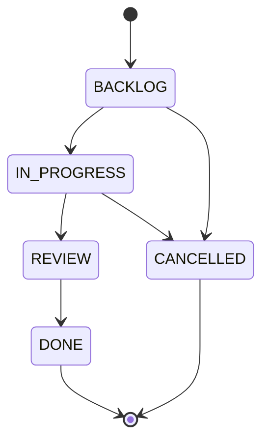
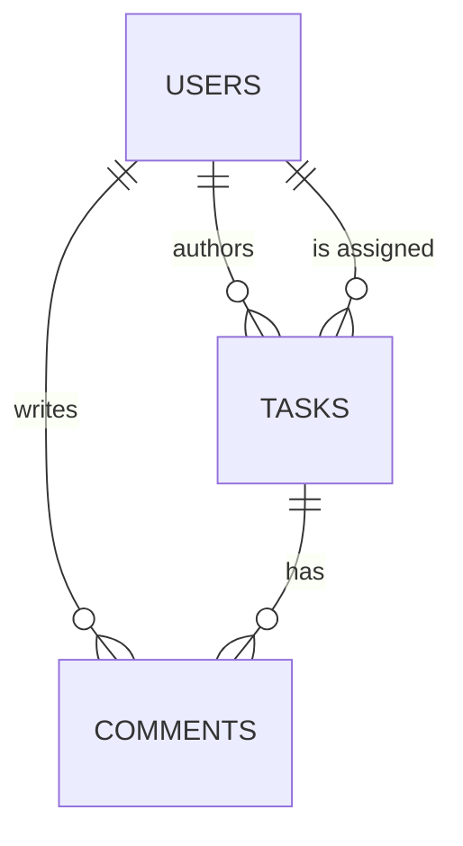

# Task Management API

[](https://github.com/maxnykoliv/TaskManagementAPI/actions/workflows/ci.yml)


An async REST API for team task tracking. Users create tasks, assign them, move
them through a strict status workflow, comment on them, and search, filter and
sort the list. A background worker auto-cancels tasks that miss their deadline.

The interesting parts are not the CRUD: they are the business rules enforced in
the service layer, a race-free per-user task limit, and a test suite that runs
every rule against a real PostgreSQL database.

## Highlights

- **Async all the way down:** FastAPI, SQLAlchemy 2.0 (async) and asyncpg.
- **Layered architecture:** router → service → repository, with a pure domain layer for the status state machine.
- **Concurrency-safe invariants:** the "max 10 active tasks per assignee" rule is checked under a `SELECT … FOR UPDATE` row lock, so parallel requests can't bypass it.
- **Auth:** JWT (OAuth2 password flow, works with Swagger's *Authorize* button), Argon2 password hashing off the event loop, and timing-safe login.
- **Background worker:** a lifespan-managed asyncio task that runs one idempotent `UPDATE`, so it is safe to run on several replicas.
- **Production basics:** Alembic migrations, Docker Compose, a non-root container with a healthcheck, pinned dependencies.
- **CI:** ruff lint and format checks, migrations checked against the models (`alembic check`), 54 tests at 97% coverage on PostgreSQL 16, and a Docker build.

## Tech stack

| Concern | Choice |
|---|---|
| Framework | FastAPI |
| ORM / driver | SQLAlchemy 2.0 (async), asyncpg |
| Database | PostgreSQL 16 |
| Migrations | Alembic |
| Validation | Pydantic v2 |
| Auth | PyJWT (HS256), pwdlib / Argon2 |
| Tests | pytest, pytest-asyncio, httpx, pytest-cov |
| Tooling | ruff, Docker, GitHub Actions |

## Quick start

Requires Docker with Compose.

```bash
cp .env.example .env
# put a random key into SECRET_KEY (must be at least 32 characters):
python -c "import secrets; print(secrets.token_hex(32))"

docker compose up --build
```

Compose starts PostgreSQL (and creates the `taskdb_test` database for tests),
applies migrations, and starts the API together with the background worker.

| URL | |
|---|---|
| http://localhost:8000/docs | Swagger UI |
| http://localhost:8000/redoc | ReDoc |
| http://localhost:8000/health | Health check |

Run the tests inside the container:

```bash
docker compose run --rm api pytest
```

## API overview

All routes are under `/api/v1` and, except register and login, require
`Authorization: Bearer <token>`.

| Method | Path | Description |
|---|---|---|
| POST | `/auth/register` | Create an account |
| POST | `/auth/login` | Get a JWT (form fields: `username` = email, `password`) |
| GET | `/auth/me` | Current user |
| POST | `/tasks` | Create a task |
| GET | `/tasks` | List tasks with search, filters, sorting and pagination |
| GET | `/tasks/overdue` | Tasks past their deadline that are not finished |
| GET | `/tasks/stats` | Counts by status and priority, plus active and overdue counts |
| GET | `/tasks/{id}` | Get a task |
| PATCH | `/tasks/{id}` | Partially update a task (all fields except status) |
| PATCH | `/tasks/{id}/status` | Change status through the state machine |
| DELETE | `/tasks/{id}` | Delete a task |
| POST | `/tasks/{id}/comments` | Add a comment |
| GET | `/tasks/{id}/comments` | List comments (paginated) |

### Example session

```bash
curl -X POST localhost:8000/api/v1/auth/register \
  -H "Content-Type: application/json" \
  -d '{"email":"alice@example.com","username":"alice","password":"password123"}'

TOKEN=$(curl -s -X POST localhost:8000/api/v1/auth/login \
  -d "username=alice@example.com&password=password123" | jq -r .access_token)

curl -X POST localhost:8000/api/v1/tasks \
  -H "Authorization: Bearer $TOKEN" -H "Content-Type: application/json" \
  -d '{"title":"Prepare the report","priority":"HIGH","deadline":"2030-01-01T12:00:00Z"}'

curl -X PATCH localhost:8000/api/v1/tasks/1/status \
  -H "Authorization: Bearer $TOKEN" -H "Content-Type: application/json" \
  -d '{"status":"IN_PROGRESS"}'

curl "localhost:8000/api/v1/tasks?search=report&priority=HIGH&sort_by=deadline&order=asc&page=1&size=20" \
  -H "Authorization: Bearer $TOKEN"
```

### Listing tasks

`GET /tasks` accepts `search` (case-insensitive, title and description),
`status`, `priority`, `assignee_id`, `deadline_from`, `deadline_to`,
`sort_by` (`created_at` | `deadline` | `priority`), `order` (`asc` | `desc`),
`page` and `size` (1–100). Unknown parameters are rejected with `422`, so a
typo is reported instead of silently returning unfiltered results.

With no `sort_by`, tasks are ordered by priority (high first) and then by
nearest deadline, with tasks that have no deadline last.

```json
{ "items": [ ... ], "total": 42, "page": 1, "size": 20, "pages": 3 }
```

### Errors

Every error has the form `{"detail": "..."}`.

| Status | Meaning |
|---|---|
| `401` | Missing or invalid token, or wrong credentials |
| `403` | The caller is neither the author nor the assignee of the task |
| `404` | Task, assignee or user not found |
| `409` | State conflict: illegal transition, editing a finished task, deleting an active task, task limit reached, duplicate account |
| `422` | Validation or business rule: deadline in the past, `DONE` without an assignee, and so on |

## Business rules



| Rule | Response |
|---|---|
| Only the transitions above are allowed, with no going back | `409` |
| A task can't become `DONE` without an assignee | `422` |
| A task can't become `DONE` after its deadline has passed | `422` |
| Deadlines can't be set in the past (checked only when the deadline changes) | `422` |
| The assignee is frozen once a task reaches `REVIEW` | `422` |
| `DONE` and `CANCELLED` tasks are read-only | `409` |
| `IN_PROGRESS` and `REVIEW` tasks can't be deleted | `409` |
| At most **10 active tasks** (`BACKLOG`, `IN_PROGRESS`, `REVIEW`) per assignee | `409` |
| Status changes only through `PATCH /tasks/{id}/status` | `status` in `PATCH /tasks/{id}` is rejected |

`PATCH /tasks/{id}` is a true partial update: omitted fields are untouched,
`"assignee_id": null` unassigns and `"deadline": null` clears the deadline.

## Architecture

```
app/
├── api/            # HTTP layer: routers, dependency wiring (session, current user, services)
├── services/       # business rules and transaction boundaries
├── repositories/   # SQLAlchemy queries, nothing else
├── domain/         # enums and the status state machine (pure, no I/O)
├── models/         # ORM models
├── schemas/        # Pydantic request/response models
├── background/     # overdue worker
├── core/           # settings, security, exception → HTTP mapping
└── db/             # engine and session factory
```

- **Routers** stay thin: they validate input and delegate to a service.
- **Services** own the rules and the transaction. They raise domain exceptions (`ConflictError`, `BusinessRuleError`, …), and a single handler maps each one to an HTTP status.
- **Repositories** keep SQL in one place, so services read as business logic.
- **Domain** has no framework imports, so the state machine is unit-tested in isolation.

### Data model



Indexes follow the hot queries: `tasks(assignee_id, status)` for the
active-task limit, `tasks(status, deadline)` for the overdue list and the
worker, plus `tasks(title)`, `users(email)` and `comments(task_id)`. Deleting a
task cascades to its comments, and deleting a user unassigns their tasks.

## Design decisions

- **Row lock for the task limit.** Counting active tasks and then inserting is a classic check-then-act race. The service locks the assignee's `users` row (`FOR UPDATE`) before counting, which serializes concurrent assignments to the same person without a table-wide lock.
- **Worker as a lifespan task, not `BackgroundTasks`.** FastAPI's `BackgroundTasks` runs once after a response and can't schedule periodic work. The worker is an asyncio task started and cancelled in the app's `lifespan`, and a failing iteration is logged without stopping the loop.
- **One idempotent statement.** Each tick runs `UPDATE tasks SET status = 'CANCELLED' WHERE deadline < now() AND status NOT IN ('DONE', 'CANCELLED')`. Running it on several replicas at once is harmless, so no leader election is needed at this scale. It bypasses the user-facing state machine on purpose: auto-cancelling a task in `REVIEW` is a system action.
- **Timing-safe login.** For an unknown email the service still verifies the password against a dummy Argon2 hash, so response time doesn't reveal which emails exist. Hashing runs in a thread pool, because Argon2 is deliberately CPU-heavy and would otherwise block the event loop.
- **Access model.** Any authenticated user can read and comment on tasks (a shared team board). Only the author or the assignee can edit, delete or move a task. The rule is in one place, `TaskService._ensure_participant`.
- **Time.** Deadlines are compared with the current instant in UTC, and naive datetimes are treated as UTC.
- **Hard delete.** Tasks are physically deleted. An audit trail would call for soft delete or an events table instead.

## Known limitations and next steps

- Registration returns `409` for a taken email, which by itself reveals which accounts exist. A public product would move to email verification and a uniform response.
- No refresh tokens or token revocation: access tokens are short-lived HS256 JWTs.
- `GET /tasks/overdue` isn't paginated.
- Offset pagination gets slower on deep pages. Keyset pagination on `(sort key, id)` would fix that.
- `ILIKE` search doesn't use an index. A `pg_trgm` GIN index or full-text search would make it scale.
- No rate limiting on `/auth/login`.

## Local development

Requires Python 3.12+ and a running PostgreSQL. The simplest option is
`docker compose up -d db`.

```bash
python -m venv .venv && source .venv/bin/activate
pip install -r requirements-dev.txt
cp .env.example .env              # and set SECRET_KEY

alembic upgrade head
uvicorn app.main:app --reload
```

Checks (the same ones CI runs):

```bash
ruff check . && ruff format --check .
alembic check                     # models and migrations are in sync
pytest --cov                      # needs TEST_DATABASE_URL
```

Every test gets a freshly created schema in the separate `taskdb_test`
database. The suite refuses to start if `TEST_DATABASE_URL` is unset or equal to
`DATABASE_URL`, so it can never wipe real data.

### Configuration

| Variable | Description | Default |
|---|---|---|
| `DATABASE_URL` | SQLAlchemy async URL | required |
| `TEST_DATABASE_URL` | Database for the test suite | — |
| `SECRET_KEY` | JWT signing key, at least 32 characters | required |
| `ACCESS_TOKEN_EXPIRE_MINUTES` | Token lifetime in minutes | `60` |
| `OVERDUE_CHECK_INTERVAL` | Worker period in seconds | `60` |
| `OVERDUE_WORKER_ENABLED` | Run the background worker | `true` |
| `POSTGRES_USER` / `POSTGRES_PASSWORD` / `POSTGRES_DB` | Used by Docker Compose | — |

### Troubleshooting

| Symptom | Fix |
|---|---|
| `401` in Swagger | Click **Authorize** and log in with your **email** in the `username` field |
| `404 Assignee not found` when creating from Swagger | Swagger pre-fills `assignee_id: 0`. Use `null` or a real user id |
| App fails at startup with a `SECRET_KEY` validation error | The key is shorter than 32 characters. Generate a new one |
| `relation "tasks" does not exist` | Run `alembic upgrade head` |
| Tests can't find `taskdb_test` | The DB volume predates the init script: `docker compose exec db psql -U taskuser -d taskdb -c "CREATE DATABASE taskdb_test;"` |

## License

[Apache 2.0](LICENSE)
